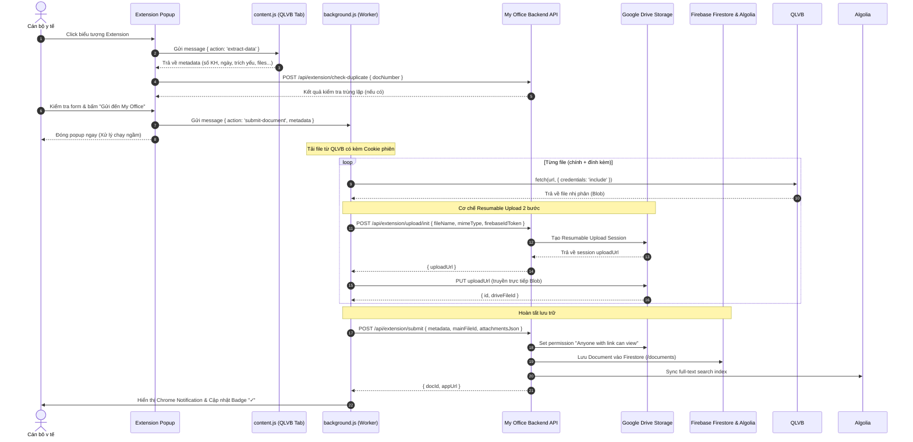

# Tài Liệu Kỹ Thuật: Cấu Trúc Hệ Thống QLVB.HPNET.VN & Cơ Chế Thu Thập Dữ Liệu Của Extension

> **Mục đích tài liệu:** Mô tả toàn diện kiến trúc DOM, cấu trúc trang, các phân hệ, cơ chế tải dữ liệu ngầm (AJAX), cấu trúc modal chi tiết văn bản của hệ thống Quản lý Văn bản Sở Y tế Hải Phòng (`qlvb.hpnet.vn`), cùng với toàn bộ nguyên lý hoạt động của Chrome Extension (`extension/`) để trích xuất dữ liệu, vượt qua rào cản xác thực (auth-wall), tải tệp và đồng bộ sang ứng dụng **My Office**.

---

## 1. Tổng Quan Kiến Trúc Nền Tảng `qlvb.hpnet.vn`

### 1.1. Công nghệ nền tảng
- **Server-side:** Microsoft ASP.NET WebForms (sử dụng `form#form1`, `__VIEWSTATE`, `__VIEWSTATEGENERATOR`, các trang `.aspx` và handler AJAX ngầm).
- **Client-side:** jQuery 1.x / 2.x, Bootstrap 3 (Modal, Popover, Dropdown), jQuery jTable plugin để kết xuất danh sách văn bản động, FontAwesome 4.
- **Xem tệp đính kèm (Previewer):**
  - Tệp PDF: Nhúng trực tiếp qua thẻ `iframe#fileView` với URL nội bộ `//qlvb.hpnet.vn/upload/...#toolbar=0`.
  - Tệp Word (`.doc`, `.docx`): Tích hợp Microsoft Office Online Web Viewer: `https://view.officeapps.live.com/op/view.aspx?src=...`.

### 1.2. Cơ chế phiên làm việc (Session) & Rào cản xác thực (Auth-wall)
- Hệ thống duy trì phiên qua cookie trình duyệt (`ASP.NET_SessionId`, cookie đăng nhập xác thực Forms Authentication).
- **Cơ chế Auth-wall:**
  - Nếu gửi HTTP request từ server bên ngoài (ví dụ Node.js / Next.js API server fetch trực tiếp URL tệp trên `qlvb.hpnet.vn`), server QLVB sẽ phát hiện thiếu cookie phiên và trả về chuỗi văn bản `"Please login!"` (kích thước chỉ ~13 bytes).
  - Trình duyệt thông thường khi fetch chéo domain (CORS) cũng bị chặn nếu không có extension can thiệp.
- **Giải pháp của Chrome Extension:**
  - Chạy trực tiếp trong ngữ cảnh trình duyệt của người dùng đã đăng nhập vào `qlvb.hpnet.vn`.
  - Extension Service Worker (`background.js`) thực hiện lệnh `fetch(url, { credentials: 'include' })` để tự động đính kèm cookie phiên của người dùng, tải file dạng nhị phân (`Blob`) thành công 100%.

---

## 2. Bản Đồ Menu, Phân Hệ & Các Tab Chính

Hệ thống điều hướng thông qua tham số truy vấn `action` trên URL gốc (`https://qlvb.hpnet.vn/?action={ID}`):

| Action ID | Tên phân hệ / Tab | Chức năng nghiệp vụ chính |
|---|---|---|
| `102` | **Văn bản đến** | Quản lý, tiếp nhận, phân phối và xử lý văn bản đến từ các đơn vị ngoài và trong ngành. |
| `101` | **Văn bản đi** | Quản lý việc soạn thảo, duyệt, ký số và phát hành văn bản đi. |
| `901` | **VB dự thảo** | Quản lý các văn bản đang trong giai đoạn soạn thảo, xin ý kiến nội bộ. |
| `110` | **Văn bản chỉ đạo / điều hành** | Các văn bản mang tính chất mệnh lệnh, chỉ đạo xuyên suốt. |
| `113` | **Hồ sơ công việc** | Gom các văn bản đến, đi thành từng tập hồ sơ vụ việc cụ thể (`vbId=...`). |
| `300` | **Trao đổi công việc** | Diễn đàn trao đổi nội bộ, ghi chú nghiệp vụ giữa các chuyên viên. |
| `198` | **Thống kê** | Báo cáo tiến độ xử lý văn bản, tình trạng quá hạn, tỷ lệ ký số. |
| `1120` | **Nhiệm vụ nội bộ** | Theo dõi các đầu mối công việc nội bộ đơn vị được phân công. |
| `112` | **Nhiệm vụ UBND TP** | Các nhiệm vụ trọng tâm do Ủy ban Nhân dân Thành phố giao ngành Y tế. |
| `816` | **Phiếu xin ý kiến** | Quy trình lấy ý kiến biểu quyết, nhận xét điện tử. |
| `818` | **PXYK Đảng ủy UB** | Phiếu xin ý kiến trực thuộc Khối Đảng ủy / Ủy ban. |
| `230` | **Lịch công tác** | Lịch họp, công tác tuần của lãnh đạo Sở và các đơn vị. |
| `214` | **Thông báo** | Bảng tin thông báo chung toàn ngành. |
| `235` | **Nhắn tin SMS** | Phân hệ gửi tin nhắn SMS brandname nhắc việc, hỏa tốc. |
| `108` | **Văn bản tham khảo** | Kho lưu trữ tài liệu quy chuẩn, chính sách dùng chung. |
| `114` | **Điểm báo** | Tổng hợp thông tin báo chí liên quan đến ngành y tế địa phương. |
| `810` | **Họp không giấy** | Phục vụ các phiên họp trực tuyến, cung cấp tài liệu họp điện tử. |
| `106` | **Tra cứu văn bản** | Màn hình tìm kiếm văn bản nâng cao theo nhiều tiêu chí. |
| `201` - `210` | **Quản trị danh mục** | `201`: Đơn vị; `202`: Nhóm người dùng; `203`: Sổ VB đến; `204`: Sổ VB đi; `206`: Loại VB đi; `208`: Loại VB đến; `210`: Chức năng hệ thống. |
| `211` / `213` / `228` | **Cá nhân hóa** | `211`: Đổi mật khẩu; `213`: Thay đổi thông tin cá nhân; `228`: Cấu hình chứng thư số / ký số. |

---

## 3. Cấu Trúc Bảng Danh Sách Văn Bản (jTable)

Màn hình danh sách văn bản (ví dụ tại `action=102` hoặc `action=101`) được điều khiển bởi thư viện jQuery jTable, với khung tìm kiếm phía trên:

### 3.1. Bộ lọc tìm kiếm nhanh (`#divFindAdv`)
- **Cơ quan ban hành:** `input#txtKeyCoquan`
- **Số ký hiệu:** `input#txtKeySoKyHieu`
- **Trích yếu:** `input#txtKeyTrichYeu`
- **Ô tìm kiếm toàn văn:** `input#txtKey` (nút kích hoạt: `button[onclick="ResetSearch();"]`)

### 3.2. Cấu trúc hàng dữ liệu (`tr.jtable-data-row`)
Container chính:
- Văn bản đến: `#SoVanbanDenTableContainer table.jtable tbody`
- Văn bản đi: `#SoVanbanDiNoiboTableContainer table.jtable tbody`

Mỗi văn bản là một thẻ `<tr>` có thuộc tính chứa định danh duy nhất (GUID):
```html
<tr class="jtable-data-row" data-record-key="77e90285-d081-4b1f-a102-c1eb23600dcc">
    <td class="text-center">
        <!-- Đánh dấu sao theo dõi -->
        <div class="div-star"><i class="fa fa-star-o" data-vanbandenid="..."></i></div>
    </td>
    <td class="click-view">397/ĐA-CC115</td>
    <td class="click-view">
        <div>
            <!-- Trích yếu hiển thị có thể rút gọn, tooltip title chứa toàn bộ trích yếu -->
            <span title="CV đề nghị cung cấp thông tin định mức kinh tế kỹ thuật...">CV đề nghị cung cấp...</span>
            <!-- Icon thể hiện có đính kèm -->
            
        </div>
    </td>
    <td class="text-center">19/06/2026</td>       <!-- Ngày ban hành -->
    <td class="text-center">Trung tâm Cấp cứu 115...</td> <!-- Cơ quan ban hành -->
    <td class="text-center">Lê Khắc Tùng</td>      <!-- Lãnh đạo chỉ đạo -->
    <td class="text-center">Bùi Minh Khôi</td>     <!-- Người thực hiện / Chuyên viên -->
    <td class="text-center">26/06/2026</td>       <!-- Hạn xử lý -->
    <td class="text-center">
        Đang xử lý<br>(còn 5 ngày)                <!-- Tình trạng & số ngày còn lại -->
    </td>
    <td class="text-center">
        <!-- Nhóm nút tác vụ nhanh -->
        <div title="Giao việc" class="jtable-phan-phoi-command-button-cus"></div>
        <div title="Trình duyệt" class="jtable-trinh-duyet-command-button-cus"></div>
        <div title="BC Hoàn thành" class="jtable-hoan-thanh-command-button-cus"></div>
        <div title="Gửi ý kiến" class="jtable-chi-dao-command-button-cus"><b>3</b></div>
        <div title="Hồ sơ công việc" class="jtable-ho-so-command-button-cus"></div>
    </td>
</tr>
```

### 3.3. Nhận diện độ khẩn (`priority`) trên bảng
Trong ô trích yếu (`td.click-view`), nếu văn bản có tính chất khẩn cấp, hệ thống chèn thêm thẻ `<span class="label ...">`:
- `label-danger` / chữ chứa `"Hỏa tốc hẹn giờ"` ➔ `express_scheduled`
- Chữ chứa `"Hỏa tốc"` ➔ `express`
- Chữ chứa `"Thượng khẩn"` ➔ `very_urgent`
- `label-warning` / chữ chứa `"Khẩn"` ➔ `urgent`
- Không có nhãn ➔ `normal`

---

## 4. Cấu Trúc Chi Tiết Khi Mở Một Văn Bản (Modals & AJAX Load)

Khi người dùng nhấp chuột vào bất kỳ ô `td.click-view` nào trên bảng:
1. Trình duyệt gọi hàm `ViewData(row_id)` (đối với VB Đến) hoặc `ViewDataVBDi(row_id)` (đối với VB Đi).
2. Hệ thống hiển thị modal Bootstrap tương ứng.
3. Đồng thời phát lệnh AJAX ngầm để lấy thông tin chi tiết dạng JSON và điền vào các thẻ trong modal.

> **Đặc điểm sống còn trong DOM:**
> **Cả 2 modal `#myModalVanbanDenView` và `#myModalVanbanDiView` luôn luôn tồn tại đồng thời trong mã nguồn HTML của trang.**
> Tuy nhiên, chỉ có đúng 1 modal được kích hoạt và điền dữ liệu thực tế tại một thời điểm!

### 4.1. AJAX Endpoints nội bộ của QLVB
- **Văn bản đến:**
  ```http
  GET /vpdt/soyte/Ajax/LoadVanBanDenInfo.aspx?VanbanDenId={GUID}
  Accept: application/json; charset=utf-8
  ```
  *Dữ liệu JSON trả về gồm:*
  `vbid`, `sokh`, `ngaybh`, `tinhtrang`, `coquanbh`, `ngaynhap`, `trichyeu`, `lanhdao`, `phongban`, `chuyenvien`, `thoihan`, `file` (tệp chính), `Files` (danh sách tệp phụ gồm `FileName`, `FilePath`), `ListDaxem`...

- **Văn bản đi:**
  ```http
  GET /vpdt/soyte/Ajax/LoadVanBanDiInfo.aspx?VanbanDiId={GUID}
  Accept: application/json; charset=utf-8
  ```
  *Dữ liệu JSON trả về gồm:*
  `vbid`, `sokh`, `ngaybh`, `tinhtrang`, `coquanbh`, `loaivanban`, `trichyeu`, `nguoiky`, `nguoiduyet`, `chuyenvien`, `thoihanhoibao`, `file`, `Files`...

---

### 4.2. Bản đồ DOM Selector chi tiết trong Modal

Mỗi modal được chia làm 2 phần chính:
- **Nửa trái (`...ViewLeft`):** Thanh thông tin tóm tắt trên cùng (`.vanban-leftinfo`) + Bộ duyệt tài liệu (`#div-fileView` hoặc `#div-fileViewVBDi`).
- **Nửa phải (`...ViewRight`):** Thông tin hành chính chi tiết (`.vanbanInfo`) + danh sách cán bộ đã xem + ý kiến xử lý.

Dưới đây là bảng đối chiếu bộ chọn (Selectors) giữa **Văn bản đến** và **Văn bản đi**:

| Trường thông tin | Selector Văn bản đến (`.vanban-`) | Selector Văn bản đi (`.vanbandi-`) | Định dạng nội dung thô trong DOM |
|---|---|---|---|
| **Số / Ký hiệu** | `.vanban-sokykieu:not(.vanban-ngaybanhanh):not(.vanban-tinhtranxuly)` | `.vanbandi-sokykieu:not(.vanbandi-ngaybanhanh):not(.vanbandi-tinhtranxuly)` | `Số/KH: 182/CCDSTE-DSTE (số đến: 1234)` hoặc `Số/KH: 50/KH-SYT` |
| **Ngày ban hành** | `.vanban-ngaybanhanh` | `.vanbandi-ngaybanhanh` | `Ban hành: 24/04/2026` |
| **Ngày giờ nhập (đầy đủ)** | `.vanhan-ngaynhap` hoặc thẻ cha của `.vanban-coquanbanhanh` | Phía sau `.vanhandi-ngaynhap` | `24/04/2026 11:25:48` (chứa cả giờ:phút:giây) |
| **Tình trạng xử lý** | `.vanban-tinhtranxuly` | `.vanbandi-tinhtranxuly` | `Tình trạng: Đang xử lý (còn 12 ngày)` |
| **Cơ quan ban hành (CQBH)** | `.vanban-coquanbanhanh` | `.vanbandi-coquanbanhanh` | `CQBH: Chi cục Dân số và Trẻ em - Sở Y tế` (VB đến) hoặc `Văn bản đi: Sở Y tế` |
| **Loại văn bản** | Thường suy ra từ ký hiệu hoặc metadata | `.vanhandi-ngaynhap` | `Loại văn bản: Kế hoạch` |
| **Trích yếu (Tiêu đề)** | `.vanban-trichyeu` | `.vanbandi-trichyeu` | `<i>Trích yếu</i>: V/v báo cáo kết quả khám sức khỏe...` |
| **Lãnh đạo / Người ký** | `.vanban-lanhdao` | `.vanbandi-nguoiky` | `<span>Lãnh đạo:</span> Lê Khắc Tùng` hoặc `<span>Người ký:</span> Nguyễn Văn A` |
| **Người duyệt** | — | `.vanbandi-nguoiduyet` | `<span>Người duyệt:</span> Giám đốc Sở` |
| **Chuyên viên / Người soạn** | `.vanban-chuyenvien` | `.vanbandi-chuyenvien` | `<span>Người thực hiện:</span> Bùi Minh Khôi ⓘ` |
| **Đơn vị xử lý** | `.vanban-phongban` | — | `<span>Đơn vị xử lý:</span> TTYT Thủy Nguyên` |
| **Thời hạn hoàn thành** | `.vanban-thoihan` | `.vanbandi-thoihanhoibao` hoặc `.vanhandi-thoihanhoibao` | `<span>Thời hạn:</span> 05/07/2026` hoặc `<span>Hạn hồi báo:</span> 01/05/2026` |
| **Liên kết văn bản gốc (Đi/Đến)**| `.vanban-vanbanketqua a` | `.vanbandi-vanbanden a` | Thẻ `<a>` liên kết giữa VB đến và VB đi trả lời |

---

### 4.3. Cấu trúc File Văn Bản Chính & File Đính Kèm

Hệ thống QLVB lưu trữ tệp tin trên thư mục web `/upload/qlvb2013/...`.

#### 1. File văn bản chính:
- Thường là file PDF ký số (có đuôi `.signed.pdf` hoặc `.pdf`).
- Nằm trong thẻ:
  - VB đến: `.vanban-taixuong a.vanban-link` hoặc thuộc tính `src` của thẻ `iframe#fileView`.
  - VB đi: `.vanbandi-taixuong a.vanbandi-link` hoặc `iframe#fileViewVBDi`.
- Văn bản trong link thường có dạng:
  `Tải xuống văn bản: Chi cuc DSTE-CV BC KSKNCT. 2026.signed.pdf`

#### 2. Nút chọn file & Menu danh sách file kèm theo:
- Khi văn bản có nhiều file (ví dụ tệp dự thảo Word, biểu mẫu Excel kèm theo):
  - Hệ thống hiển thị nút bấm: `<button id="btnChonFiles">Chọn file <span class="caret"></span></button>`.
  - Danh sách file nằm trong container: `#vanban-file-items` (hoặc `#vanbandi-file-items`).
- Mỗi tệp đính kèm được biểu diễn bằng thẻ:
  ```html
  <p class="vanban-file-item">
      <a href="javascript:ChangeFile('//qlvb.hpnet.vn/upload/qlvb2013/van-ban-den/2026/04/24/.../BIEU KQ KSK NCT.2026.xlsx')">
          BIEU KQ KSK NCT.2026.xlsx
      </a>
  </p>
  ```
- **Hàm chuyển file:**
  - VB đến dùng hàm: `ChangeFile(filePath)`
  - VB đi dùng hàm: `ChangeFileVanBanDi(filePath)`
  - Thuộc tính `href` hoặc `onclick` chứa đường dẫn tương đối hoặc protocol-relative (`//qlvb.hpnet.vn/...`).

---

## 5. Cơ Chế Thu Thập Dữ Liệu Của Extension (`content.js`)

Để đảm bảo trích xuất chính xác 100% trong mọi trường hợp, `content.js` tuân thủ các nguyên tắc sau:

### 5.1. Nhận diện Prefix đang hoạt động (`detectActivePrefix`)
Vì cả hai modal đều có trong DOM, script kiểm tra xem prefix nào đang chứa dữ liệu thực tế (dựa vào độ dài ký tự của `.sokykieu` sau khi bóc tách nhãn):
```javascript
function detectActivePrefix() {
  const prefixes = ['vanban-', 'vanbandi-'];
  for (const p of prefixes) {
    const el = document.querySelector('.' + p + 'sokykieu:not(.' + p + 'ngaybanhanh):not(.' + p + 'tinhtranxuly)');
    if (el) {
      let text = el.textContent.trim();
      // Bỏ tiền tố "Số/KH:"
      const colonIdx = text.indexOf(':');
      if (colonIdx >= 0) text = text.substring(colonIdx + 1).trim();
      // Bỏ hậu tố "(số đến: ...)"
      const parenIdx = text.indexOf('(');
      if (parenIdx >= 0) text = text.substring(0, parenIdx).trim();
      
      if (text.length > 0) {
        return { prefix: '.' + p, docNumber: text };
      }
    }
  }
  return null;
}
```

### 5.2. Chuẩn hóa và làm sạch dữ liệu
- **Trích yếu:** Loại bỏ chuỗi regex `/^Trích yếu\s*:\s*/i`.
- **Người thực hiện / Lãnh đạo:** Cắt bỏ icon tooltip và chuỗi rác `\s*ⓘ.*$`.
- **Ngày ban hành:** Ưu tiên quét chuỗi regex `\d{1,2}\/\d{1,2}\/\d{4}\s+\d{1,2}:\d{2}` từ vùng thông tin chi tiết để lấy chính xác giờ phút, fallback về `.vanban-ngaybanhanh`.
- **Độ khẩn:** Đọc ngược lên thẻ `tr[data-record-key]` trên bảng cha để trích xuất `priority`.

### 5.3. Trích xuất danh sách tệp đính kèm toàn diện
Script quét toàn bộ các thẻ thỏa mãn danh sách selector:
```javascript
const fileItemSelectors = [
  prefix + 'file-item a',
  '#' + pClean + 'file-items a',
  '.' + pClean + 'file-items a',
  '.dropdown-menu a',
  '.btn-group ul a',
  'a[onclick*="ChangeFile"]',
  'a[href*="ChangeFile"]',
  'a[href*="/upload/"]',
  'a[href*=".pdf"]',
  'a[href*=".doc"]',
  'a[href*=".docx"]',
  'a[href*=".xlsx"]'
];
```
Với mỗi thẻ `<a>`:
- Dùng regex `/(?:ChangeFile|ChangeFileVanBanDi)\(\s*['"](.+?)['"]\s*\)/i` để trích xuất link tệp từ lệnh JavaScript.
- Nếu đường dẫn bắt đầu bằng `//`, tự động bổ sung `https:`.
- Dùng `Set` để loại bỏ các URL trùng lặp.
- Luôn đưa tệp văn bản chính (file ký số PDF từ `.vanban-link`) lên vị trí đầu tiên (`index 0`).

---

## 6. Cơ Chế Đẩy Dữ Liệu Sang Ứng Dụng My Office

Toàn bộ quy trình từ lúc người dùng mở Extension Popup đến khi văn bản được lưu trữ vĩnh viễn trên Google Drive và Firestore:



### 6.1. Quy chuẩn đặt tên tệp chuẩn hóa (`_buildFilename`)
Tất cả các file tải về từ QLVB được đổi tên tự động theo chuẩn trước khi đẩy lên Google Drive:
- **Định dạng file chính:** `[YYYYMMDD]-[SoKyHieu]-[TenFileGocKhongDau].[ext]`
- **Định dạng file đính kèm:** `[YYYYMMDD]-[SoKyHieu]-kem-[TenFileGocKhongDau].[ext]`
- Ví dụ:
  - Tệp gốc: `Chi cuc DSTE-CV BC KSKNCT. 2026.signed.pdf`
  - Ngày ban hành: `24/04/2026`, Số KH: `182/CCDSTE-DSTE`
  - Tên tệp chuẩn hóa: `20260424-182.CCDSTE.DSTE-Chi-cuc-DSTE-CV-BC-KSKNCT.-2026.signed.pdf`

### 6.2. Cơ chế Upload 2 bước (Resumable Upload)
- **Vấn đề hạn chế:** Nền tảng Vercel Serverless có giới hạn cứng (Payload Limit) là **4.5 MB** cho mỗi HTTP request. Các file tài liệu quét (scan PDF) hoặc phụ lục dung lượng lớn từ 10MB – 50MB sẽ bị lỗi `413 Payload Too Large`.
- **Giải pháp:**
  1. `background.js` gọi `/api/extension/upload/init` kèm `fileName`, `mimeType` và `firebaseIdToken`.
  2. Server backend sử dụng Google OAuth client (hoặc Service Account) gọi Google Drive API tạo một phiên upload tạm thời (`uploadType=resumable`) trong thư mục chỉ định (`DRIVE_FOLDER_ID`), nhận về `location` header (`uploadUrl`).
  3. `background.js` trực tiếp thực hiện lệnh HTTP `PUT uploadUrl` đẩy toàn bộ binary `Blob` lên Google Drive.
  4. Google Drive trả về `id` và `mimeType` của tệp đã tạo.
  5. Quy trình này **không tiêu tốn băng thông hay bộ nhớ của Vercel server**, cho phép upload các file dung lượng hàng trăm megabyte mượt mà.

### 6.3. Cơ chế Xác thực & Tự động Làm mới Token (Silent Auth)
- **Đồng bộ Token (`token-sync.js`):** Khi người dùng mở ứng dụng My Office (`localhost:3000` hoặc domain Vercel), script `token-sync.js` tự động đọc `firebase_id_token` và `firebase_refresh_token` từ `localStorage` và lưu vào `chrome.storage.local`.
- **Tự động làm mới khi hết hạn:**
  - Firebase ID Token có hiệu lực 60 phút.
  - Trước mỗi lần upload/submit, `background.js` giải mã JWT payload. Nếu còn dưới 60 giây là hết hạn, nó tự động gửi request đến:
    ```http
    POST https://securetoken.googleapis.com/v1/token?key={FIREBASE_API_KEY}
    grant_type=refresh_token&refresh_token={myoffice_refresh_token}
    ```
  - Cập nhật lại ID Token mới vào `chrome.storage.local` hoàn toàn âm thầm mà không làm gián đoạn người dùng.

### 6.4. Đảm bảo toàn vẹn dữ liệu tại `/api/extension/submit`
Khi nhận payload từ Extension, endpoint server:
1. Xác minh `firebaseIdToken` hợp lệ qua REST API (`verifyIdTokenREST`).
2. Thiết lập quyền đọc công khai `"Anyone with link can view"` cho các tệp Drive (`drive.permissions.create`).
3. Chuẩn hóa ngày tháng (`parseDate` từ format `DD/MM/YYYY HH:mm:ss` sang Firestore `Timestamp`).
4. Ghi document vào collection `/documents` với trạng thái ban đầu là `status: 'pending'`.
5. Đẩy metadata vào Algolia Index (`syncToAlgolia`) phục vụ tìm kiếm toàn văn tức thì.
6. Lưu lại nhật ký trong ngày (`submissionHistory`) của Extension để tránh gửi lặp và hiển thị bảng lịch sử trực quan.

---

## 7. Hướng Dẫn Dành Cho Nhà Phát Triển / Claude Code Khi Nâng Cấp

1. **Khi giao diện QLVB thay đổi:**
   - Kiểm tra xem tên class trong `#myModalVanbanDenView` hoặc `#myModalVanbanDiView` có bị đổi không.
   - Nếu QLVB bổ sung modal mới, thêm prefix tương ứng vào `detectActivePrefix()` trong `extension/content.js`.
2. **Khi mở rộng trường dữ liệu (ví dụ: bốc thêm Lịch sử xử lý, Danh sách người phối hợp):**
   - Đọc các thẻ `.vanban-daxem`, `.show-phong-ph`, `.show-chuyenvien-ph`.
   - Bổ sung trường vào schema `CreateDocumentInput` trong `types/index.ts` và xử lý trong `app/api/extension/submit/route.ts`.
3. **Thư mục mã nguồn liên quan:**
   - Logic trích xuất DOM: [`extension/content.js`](file:///Users/buiminhkhoi/Documents/Antigravity/Claude/my-office/extension/content.js)
   - Logic background & upload Drive: [`extension/background.js`](file:///Users/buiminhkhoi/Documents/Antigravity/Claude/my-office/extension/background.js)
   - Giao diện & kiểm tra trùng: [`extension/popup.js`](file:///Users/buiminhkhoi/Documents/Antigravity/Claude/my-office/extension/popup.js)
   - API khởi tạo session upload Drive: [`app/api/extension/upload/init/route.ts`](file:///Users/buiminhkhoi/Documents/Antigravity/Claude/my-office/app/api/extension/upload/init/route.ts)
   - API ghi văn bản vào hệ thống: [`app/api/extension/submit/route.ts`](file:///Users/buiminhkhoi/Documents/Antigravity/Claude/my-office/app/api/extension/submit/route.ts)
